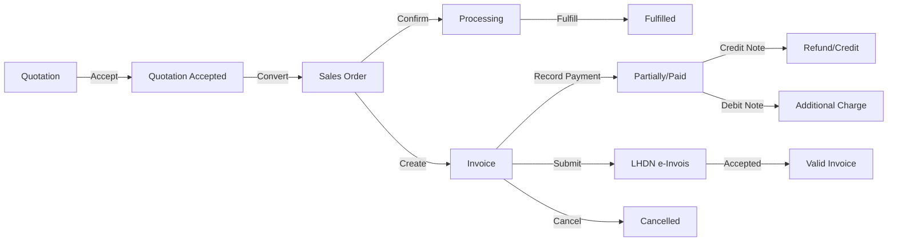

# B-Invoicing — Quotation, Invoice & e-Invois LHDN

**Modul:** B-Invoicing  
**Status:** Production Ready  
**Pemilikan Domain:** Quotation, Sales Order, Invoice, Credit Note, Debit Note, Receipt, Recurring Billing  

---

## Ringkasan

B-Invoicing ialah modul lengkap untuk pengurusan dokumen jualan dari quotation sehingga pembayaran, dengan sokongan penuh untuk **e-Invois LHDN** (Malaysia).

### Ciri-ciri Utama

| Ciri | Keterangan |
|------|------------|
| **Quotation Management** | Buat, hantar, lulus, tukar ke sales order |
| **Sales Order** | Urus tempahan pelanggan dengan tracking status |
| **Invoice** | Create from order, record payment, track outstanding |
| **Credit Note** | Return/damage/overcharge dengan auto-apply ke invoice |
| **Debit Note** | Undercharge/additional services price adjustment |
| **Receipt** | Record payments dengan multiple payment methods |
| **Recurring Billing** | Subscription, retainer, usage-based billing automation |
| **e-Invois LHDN** | Submit, validate, cancel mengikut spesifikasi LHDN |

---

## Struktur Modul

```
app/Modules/Invoicing/
├── InvoicingServiceProvider.php          # Service provider dengan bindings
├── README.md                             # Dokumentasi ini
├── config/
│   └── invoicing.php                     # Konfigurasi tax, e-Invois, numbering
├── Models/
│   ├── Quotation.php                     # Quotation dengan auto-numbering
│   ├── SalesOrder.php                    # Sales order dari quotation
│   ├── SalesOrderItem.php                # Line items untuk order
│   ├── Invoice.php                       # Invoice dengan e-Invois fields
│   ├── InvoiceItem.php                   # Line items untuk invoice
│   ├── CreditNote.php                    # Credit note dengan apply tracking
│   ├── DebitNote.php                     # Debit note untuk adjustment
│   ├── Receipt.php                       # Payment receipt
│   └── RecurringBilling.php              # Subscription billing automation
├── Services/
│   ├── InvoiceService.php                # CRUD quotation, invoice, payment
│   ├── RecurringBillingService.php       # Auto-billing processing
│   └── EInvoisService.php                # LHDN MyInvois API integration
├── Http/Controllers/
│   ├── QuotationController.php           # Quotation CRUD + actions
│   ├── InvoiceController.php             # Invoice + payment + e-Invois
│   ├── CreditNoteController.php          # Credit note management
│   └── RecurringBillingController.php    # Recurring billing CRUD
├── database/migrations/
│   ├── 2026_10_19_000050_create_quotations_table.php
│   ├── 2026_10_19_000051_create_sales_orders_table.php
│   ├── 2026_10_19_000052_create_invoices_table.php
│   ├── 2026_10_19_000053_create_credit_debit_notes_receipts_table.php
│   └── 2026_10_19_000054_create_recurring_billings_table.php
└── routes/api.php                        # API endpoints
```

---

## Aliran Dokumen Jualan



---

## Database Schema

### Quotation
- `quotation_number` - Unique (QT-YYYY-NNNNN)
- Customer info, dates, financials
- Status: draft, pending, accepted, rejected, expired, converted
- Auto-expiry calculation dari validity_days

### Sales Order
- `order_number` - Unique (SO-YYYY-NNNNN)
- Source dari quotation_id
- Billing/shipping addresses
- Status: pending, confirmed, processing, shipped, fulfilled, cancelled

### Invoice
- `invoice_number` - Unique (INV-YYYY-NNNNN)
- e-Invois fields: submission_status, reference_no (UUID), rejection_reason
- Payment tracking: amount_paid, amount_outstanding
- Status: draft, issued, partial, paid, overdue, cancelled

### Credit/Debit Note
- Credit: original_amount, credit_amount, applied_amount, remaining_credit
- Debit: amount untuk additional charges
- Status tracking dengan expiry untuk credit notes

### Recurring Billing
- billing_type: subscription, retainer, usage-based, milestone
- frequency: daily, weekly, monthly, quarterly, annually
- Auto-send invoice & reminder settings
- Tracking: total_invoices_generated, last_billing_date

---

## API Endpoints

### Quotation

```
GET    /api/v1/invoicing/quotations              # List quotations
POST   /api/v1/invoicing/quotations              # Create quotation
GET    /api/v1/invoicing/quotations/{id}         # Show quotation
PUT    /api/v1/invoicing/quotations/{id}         # Update quotation
POST   /api/v1/invoicing/quotations/{id}/submit  # Submit for approval
POST   /api/v1/invoicing/quotations/{id}/accept  # Accept quotation
POST   /api/v1/invoicing/quotations/{id}/reject  # Reject quotation
POST   /api/v1/invoicing/quotations/{id}/convert-order  # Convert to SO
DELETE /api/v1/invoicing/quotations/{id}         # Delete quotation
```

### Invoice

```
GET    /api/v1/invoicing/invoices                # List invoices
GET    /api/v1/invoicing/invoices/statistics     # Statistics
GET    /api/v1/invoicing/invoices/{id}           # Show invoice
POST   /api/v1/invoicing/invoices/from-order/{id} # Create from SO
POST   /api/v1/invoicing/invoices/{id}/payment   # Record payment
POST   /api/v1/invoicing/invoices/{id}/submit-einvois  # Submit LHDN
POST   /api/v1/invoicing/invoices/{id}/cancel    # Cancel invoice
```

### Credit Note

```
GET    /api/v1/invoicing/credit-notes            # List credit notes
POST   /api/v1/invoicing/credit-notes            # Create credit note
POST   /api/v1/invoicing/credit-notes/{id}/apply # Apply to invoice
```

### Recurring Billing

```
GET    /api/v1/invoicing/recurring-billings      # List billings
GET    /api/v1/invoicing/recurring-billings/upcoming  # Upcoming schedule
POST   /api/v1/invoicing/recurring-billings      # Create schedule
PUT    /api/v1/invoicing/recurring-billings/{id} # Update schedule
POST   /api/v1/invoicing/recurring-billings/{id}/pause    # Pause
POST   /api/v1/invoicing/recurring-billings/{id}/resume   # Resume
POST   /api/v1/invoicing/recurring-billings/{id}/cancel   # Cancel
POST   /api/v1/invoicing/recurring-billings/{id}/process-now  # Process now
```

---

## Permissions

| Permission | Akses |
|------------|-------|
| `invoicing.view` | Lihat quotation, invoice, credit/debit note |
| `invoicing.manage` | Urus quotation, invoice, payment, recurring billing |
| `invoicing.approve` | Lulus invoice & hantar ke LHDN e-Invois |
| `invoicing.reports` | Akses laporan invoicing |

---

## Configuration

### config/invoicing.php

```php
// Tax (SST Malaysia)
'tax' => [
    'sst_rate' => 8,  // 6% atau 8% untuk sales tax
    'enable_sst' => true,
],

// e-Invois LHDN
'einvois' => [
    'enabled' => true,
    'api_base_url' => 'https://sandbox-api.myinvois.hasil.gov.my/v1',
    'api_key' => env('INVOICING_EINVOIS_API_KEY'),
    'environment' => 'sandbox',  // sandbox | production
],

// Default settings
'defaults' => [
    'payment_terms_days' => 30,
    'quotation_validity_days' => 30,
],
```

---

## e-Invois LHDN Integration

### Spesifikasi
- **API URL:** https://myinvois.hasil.gov.my/
- **Format:** JSON mengikut LHDN specification
- **Validation:** Invoice type, commodity code, tax rates (0%, 6%, 8%, 10%)
- **Submission:** UUID dari LHDN untuk setiap invoice yang diterima

### Workflow
1. Validate invoice data (customer tax ID, required fields)
2. Build payload mengikut format LHDN
3. Submit ke API (sandbox/production)
4. Receive UUID & status (VALIDATED/INVALID)
5. Store reference_no dalam invoice record
6. Handle rejection dengan reason

### Compliance Notes
> ⚠️ Integrasi e-Invois perlu disahkan dengan dokumentasi rasmi LHDN.  
> @see https://myinvois.hasil.gov.my/ untuk spesifikasi terkini.

---

## Malaysian Compliance

| Requirement | Implementation |
|-------------|----------------|
| **e-Invois LHDN** | Full API integration dengan validation |
| **SST** | Configurable 6%/8% sales tax |
| **PDPA 2010** | Customer data protection dalam semua transaksi |
| **Akta Akuntansi 2013** | Audit trail untuk semua dokumen kewangan |
| **Retention Policy** | 7 tahun untuk rekod kewangan (configurable) |

---

## Testing Checklist

- [ ] Quotation creation dengan lines
- [ ] Auto-numbering (QT-YYYY-NNNNN)
- [ ] Expiry date calculation
- [ ] Convert quotation → sales order
- [ ] Create invoice from sales order
- [ ] Record partial/full payment
- [ ] Auto-status update (partial → paid)
- [ ] Credit note creation & apply
- [ ] Debit note creation
- [ ] Recurring billing schedule
- [ ] Auto-process due billings
- [ ] e-Invois validation
- [ ] e-Invois submission (sandbox)
- [ ] Overdue detection
- [ ] Statistics calculation

---

## Related Modules

| Module | Relationship |
|--------|--------------|
| **B-CRM** | Quotation dari customer/lead |
| **B-Inventory** | Stock deduction pada fulfillment |
| **B-Finance** | Journal posting untuk invoice/payment |
| **B-Payroll** | Invoice untuk professional practice billing |
| **B-Notify** | Email/SMS reminder untuk overdue |

---

## Version History

| Version | Date | Changes |
|---------|------|---------|
| 1.0.0 | 2026-10-19 | Initial implementation |

---

**Dokumen ini adalah spesifikasi perancangan. Implementasi sebenar mungkin berbeza.**
