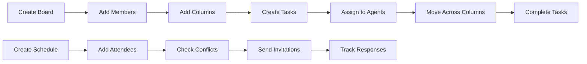

# B-Virtual Office — Agent, Task, Board & Schedule Management

**Modul:** B-Virtual Office  
**Status:** Production Ready  
**Pemilikan Domain:** Agent, Task, Board, Schedule  

---

## Ringkasan

B-Virtual Office ialah modul pengurusan tugas dan kolaborasi pasukan yang lengkap dengan sokongan untuk **kanban boards**, **task management**, **agent collaboration** (human & AI), dan **scheduling/meeting management**.

### Ciri-ciri Utama

| Ciri | Keterangan |
|------|------------|
| **Agent Management** | Urus ahli pasukan & AI agents dengan status real-time |
| **Kanban Boards** | Board visual dengan columns customizable |
| **Task/Cards** | Buat, assign, move, reorder tasks dengan drag & drop |
| **Checklists** | Checklist items dalam setiap task dengan progress tracking |
| **Comments & History** | Kolaborasi melalui comments & audit trail |
| **Scheduling** | Meeting scheduling dengan conflict detection |
| **Recurring Events** | Sokongan recurring meetings (RRULE format) |
| **Statistics** | Dashboard statistics untuk boards & schedules |

---

## Struktur Modul

```
app/Modules/VirtualOffice/
├── VirtualOfficeServiceProvider.php    # Service provider dengan bindings
├── README.md                           # Dokumentasi ini
├── config/
│   └── virtual_office.php              # Konfigurasi assignment, boards, schedule
├── Models/
│   ├── Agent.php                       # Team member/AI agent dengan status
│   ├── Board.php                       # Kanban board dengan visibility
│   ├── BoardMember.php                 # Board membership dengan roles
│   ├── Column.php                      # Columns dalam board
│   ├── Card.php                        # Tasks/cards dalam columns
│   ├── CardComment.php                 # Comments pada cards
│   ├── CardHistory.php                 # Audit trail card changes
│   └── Schedule.php                    # Meetings/events dengan attendees
│   └── ScheduleAttendee.php            # Attendee responses
├── Services/
│   ├── TaskService.php                 # CRUD tasks, move, reorder, complete
│   ├── BoardService.php                # CRUD boards, members, columns
│   ├── ScheduleService.php             # Scheduling, conflict detection
│   └── AgentService.php                # Agent management & status
├── Http/Controllers/
│   ├── AgentController.php             # Agent CRUD + status updates
│   ├── BoardController.php             # Board CRUD + members + columns
│   ├── TaskController.php              # Task CRUD + move/reorder/assign
│   └── ScheduleController.php          # Schedule CRUD + respond
├── database/migrations/
│   ├── 2026_10_19_000100_create_vo_agents_table.php
│   ├── 2026_10_19_000101_create_vo_boards_tables.php
│   └── 2026_10_19_000102_create_vo_schedules_tables.php
└── routes/api.php                      # API endpoints
```

---

## Aliran Kerja



---

## Database Schema

### vo_agents
- `name`, `email`, `type` (human/ai/hybrid)
- `status`: idle, active, busy, offline
- `role`, `avatar_url`, `metadata`
- `last_active_at` untuk tracking availability

### vo_boards
- `name`, `description`, `visibility` (private/team/public)
- `color`, `settings` (JSON)
- `archived_at` untuk soft archive

### vo_board_members
- `board_id`, `user_id`, `role` (owner/editor/viewer)
- Unique constraint: board_id + user_id

### vo_columns
- `board_id`, `name`, `position`, `is_default`
- Default columns: To Do, In Progress, Review, Done

### vo_cards (Tasks)
- `board_id`, `column_id`, `assigned_to` (agent)
- `title`, `description`, `priority`, `status`
- `due_date`, `labels`, `attachments`, `checklist`
- `completed_at` untuk tracking completion time

### vo_card_comments
- `card_id`, `user_id`, `body`
- Full comment thread per task

### vo_card_history
- `card_id`, `user_id`, `action`, `changes` (JSON)
- Complete audit trail untuk semua perubahan

### vo_schedules
- `tenant_id`, `agent_id`, `title`, `description`
- `start_time`, `end_time`, `type` (meeting/standup/etc)
- `is_recurring`, `recurrence_pattern` (RRULE)
- `location`, `meeting_link`, `status`

### vo_schedule_attendees
- `schedule_id`, `user_id`, `response` (pending/accepted/declined/tentative)
- `responded_at` untuk tracking response time

---

## API Endpoints

### Agents

```
GET    /api/v1/agents                          # List agents
POST   /api/v1/agents                          # Create agent
GET    /api/v1/agents/{id}                     # Show agent
PUT    /api/v1/agents/{id}                     # Update agent
POST   /api/v1/agents/{id}/status              # Update status
GET    /api/v1/agents/statistics               # Agent statistics
DELETE /api/v1/agents/{id}                     # Delete agent
```

### Boards

```
GET    /api/v1/boards                          # List boards
POST   /api/v1/boards                          # Create board
GET    /api/v1/boards/{id}                     # Show board with structure
PUT    /api/v1/boards/{id}                     # Update board
POST   /api/v1/boards/{id}/members             # Add member
DELETE /api/v1/boards/{id}/members             # Remove member
POST   /api/v1/boards/{id}/archive             # Archive board
POST   /api/v1/boards/{id}/restore             # Restore archived board
POST   /api/v1/boards/{id}/duplicate           # Duplicate board
DELETE /api/v1/boards/{id}                     # Delete board
POST   /api/v1/boards/{id}/columns             # Add column
DELETE /api/v1/boards/{id}/columns             # Delete column
```

### Tasks/Cards

```
GET    /api/v1/tasks                           # List tasks (with filters)
POST   /api/v1/tasks                           # Create task
GET    /api/v1/tasks/{id}                      # Show task
PUT    /api/v1/tasks/{id}                      # Update task
POST   /api/v1/tasks/{id}/move                 # Move to column (drag & drop)
POST   /api/v1/tasks/reorder                   # Reorder within column
POST   /api/v1/tasks/{id}/complete             # Complete task
POST   /api/v1/tasks/{id}/comments             # Add comment
POST   /api/v1/tasks/{id}/assign               # Assign to agent
GET    /api/v1/tasks/overdue                   # Get overdue tasks
GET    /api/v1/tasks/statistics                # Board statistics
DELETE /api/v1/tasks/{id}                      # Delete task
```

### Schedules

```
GET    /api/v1/schedules                       # List schedules
POST   /api/v1/schedules                       # Create schedule
GET    /api/v1/schedules/{id}                  # Show schedule
PUT    /api/v1/schedules/{id}                  # Update schedule
POST   /api/v1/schedules/{id}/cancel           # Cancel schedule
POST   /api/v1/schedules/{id}/complete         # Complete schedule
POST   /api/v1/schedules/{id}/respond          # Respond to invitation
GET    /api/v1/schedules/today                 # Today's schedules
GET    /api/v1/schedules/upcoming              # Upcoming schedules
GET    /api/v1/schedules/statistics            # Schedule statistics
DELETE /api/v1/schedules/{id}                  # Delete schedule
```

---

## Permissions

| Permission | Akses |
|------------|-------|
| `virtual_office.view` | Lihat agents, tasks, boards & schedules |
| `virtual_office.manage` | Urus agents, tasks, boards, columns & schedules |

---

## Configuration

### config/virtual_office.php

```php
// Assignment rules
'assignment' => [
    'auto_assign_enabled' => false,
    'max_concurrent_tasks' => 5,
    'priority_levels' => ['low', 'medium', 'high', 'urgent'],
],

// Board settings
'boards' => [
    'max_columns_per_board' => 10,
    'default_column_names' => ['To Do', 'In Progress', 'Review', 'Done'],
    'card_limit_per_user' => 50,
],

// Schedule settings
'schedule' => [
    'timezone' => 'Asia/Kuala_Lumpur',
    'working_hours_start' => '09:00',
    'working_hours_end' => '18:00',
    'reminder_minutes_before' => [15, 60],
],

// Agent settings
'agents' => [
    'types' => ['human', 'ai', 'hybrid'],
    'ai_status_levels' => ['idle', 'active', 'busy', 'offline'],
    'max_agents_per_tenant' => 20,
],
```

---

## Features Detail

### 1. Agent Management

Agents boleh jadi **human** atau **AI** dengan status real-time:
- **Idle**: Available, tidak ada tugas aktif
- **Active**: Sedang bekerja
- **Busy**: Sibuk dengan tugas
- **Offline**: Tidak tersedia

### 2. Kanban Boards

Boards dengan **customizable columns**:
- Default: To Do → In Progress → Review → Done
- Custom columns boleh ditambah/dipadam
- Visibility: Private, Team, Public
- Members dengan roles: Owner, Editor, Viewer
- Drag & drop cards antara columns
- Reorder cards dalam column

### 3. Task/Cards

Full-featured task management:
- **Priority**: Low, Medium, High, Urgent
- **Due dates** dengan overdue detection
- **Assign to agents** dengan workload tracking
- **Labels/tags** untuk categorization
- **Checklists** dengan progress percentage
- **Attachments** support
- **Comments** thread
- **History** audit trail untuk semua changes

### 4. Scheduling

Meeting & event management:
- **Conflict detection** - auto-flag overlapping schedules
- **Recurring events** - RRULE format support
- **Attendee management** - accept/decline/tentative responses
- **Today view** - quick access to today's meetings
- **Upcoming view** - upcoming schedules with filtering
- **Statistics** - scheduled vs completed vs cancelled

---

## Malaysian Compliance

| Requirement | Implementation |
|-------------|----------------|
| **PDPA 2010** | User data protection dalam semua records |
| **Audit Trail** | Card history tracking untuk compliance |
| **Data Retention** | Configurable retention policy |

---

## Testing Checklist

- [ ] Agent creation (human & AI types)
- [ ] Status updates (idle/active/busy/offline)
- [ ] Board creation with default columns
- [ ] Custom columns addition/deletion
- [ ] Board member management (add/remove)
- [ ] Board visibility (private/team/public)
- [ ] Board archive/restore
- [ ] Board duplication
- [ ] Task creation with all fields
- [ ] Task assignment to agents
- [ ] Task move between columns (drag & drop simulation)
- [ ] Task reorder within column
- [ ] Task completion with timestamp
- [ ] Task comments
- [ ] Task checklist progress
- [ ] Overdue task detection
- [ ] Task statistics calculation
- [ ] Schedule creation with attendees
- [ ] Conflict detection on schedule
- [ ] Recurring schedule support
- [ ] Attendee response tracking
- [ ] Today's schedules view
- [ ] Upcoming schedules view
- [ ] Schedule statistics

---

## Related Modules

| Module | Relationship |
|--------|--------------|
| **B-Payroll** | Employee data untuk agents |
| **B-CRM** | Task untuk follow-up leads/customers |
| **B-Projects** | Integration dengan project tasks |
| **B-Helpdesk** | Ticket sebagai tasks |
| **B-Notify** | Email/SMS reminder untuk due dates |

---

## Version History

| Version | Date | Changes |
|---------|------|---------|
| 1.0.0 | 2026-10-19 | Initial implementation |

---

**Dokumen ini adalah spesifikasi perancangan. Implementasi sebenar mungkin berbeza.**
